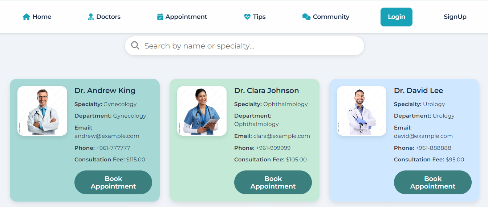
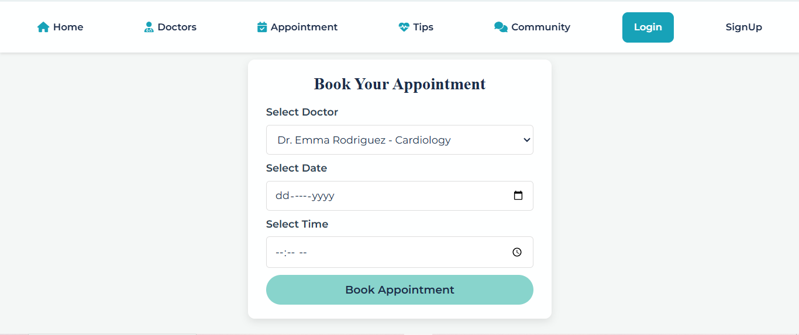
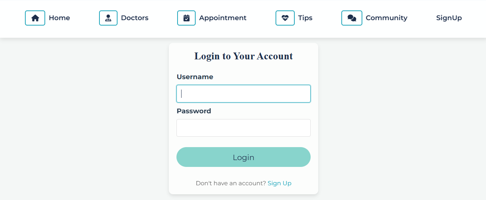
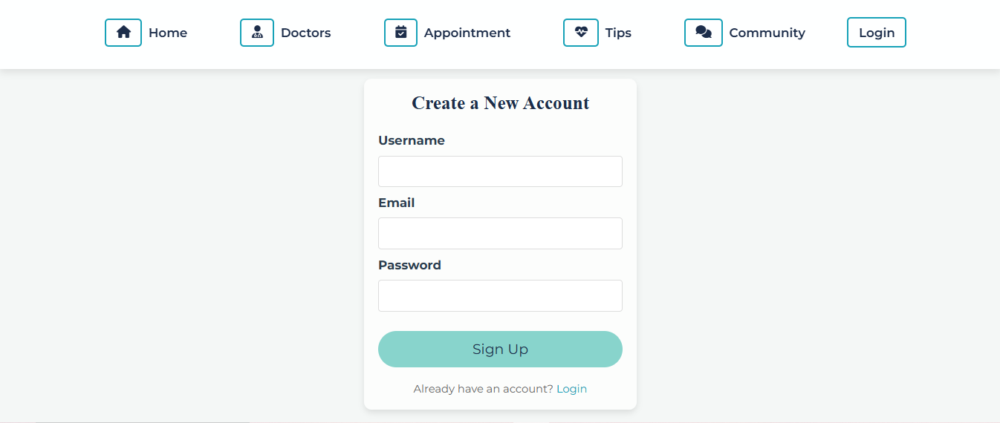
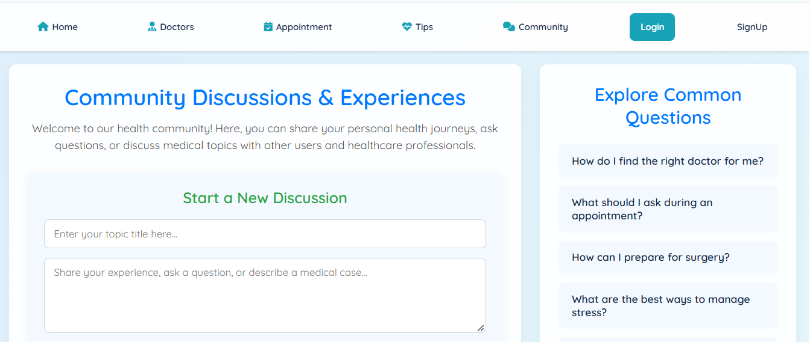
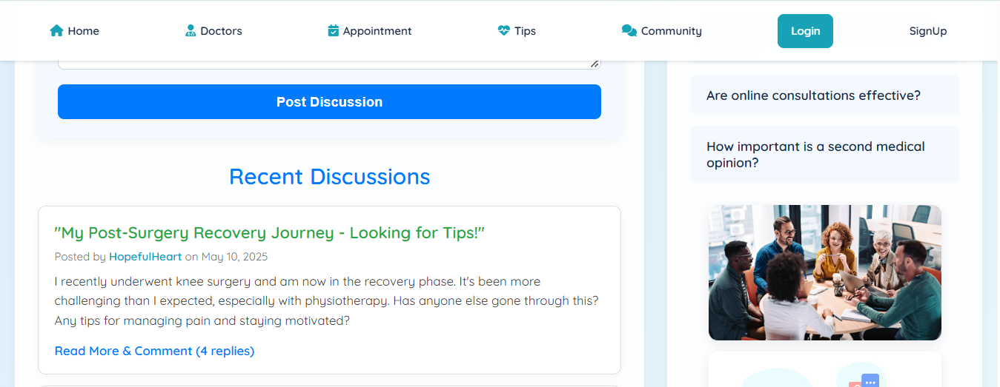
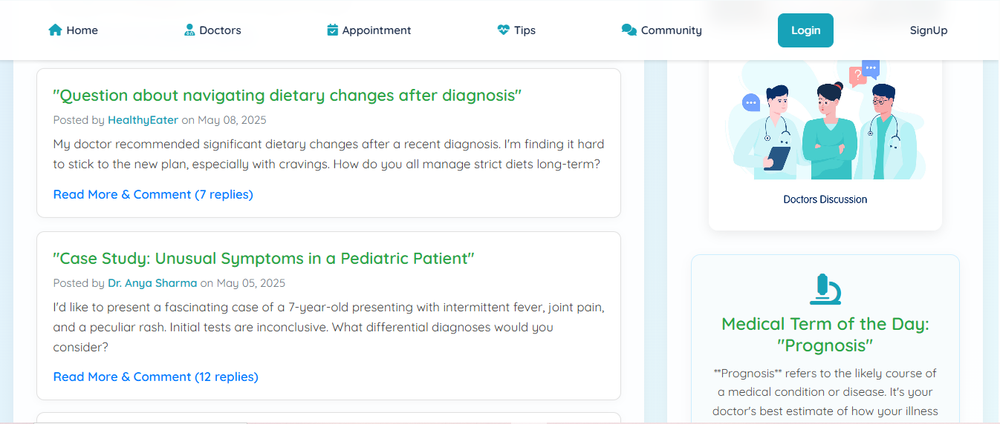
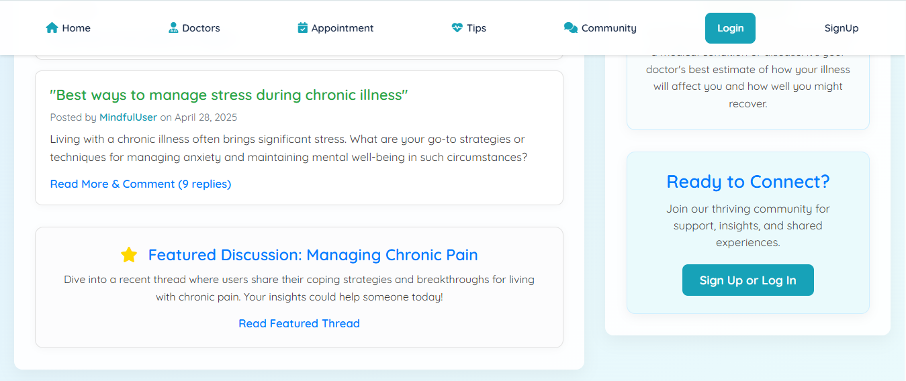
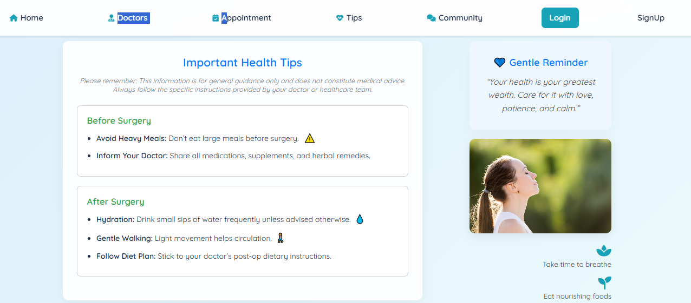
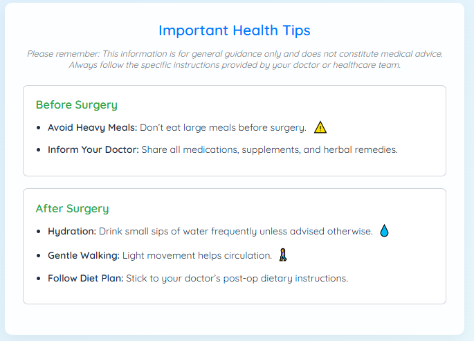

# 🩺 MediCommunity


**MediCommunity** is a healthcare web application that brings patients and healthcare resources together in one place. Browse doctors, request appointments, read health tips, and engage with a health-focused community, all from a single, easy-to-use interface.


---

## 📑 Table of Contents

- [Features](#-features)
- [Screenshots](#-screenshots)
- [Tech Stack](#️-tech-stack)
- [Project Structure](#-project-structure)
- [Getting Started](#-getting-started)
- [Troubleshooting](#-troubleshooting)
- [Security Notes](#-security-notes)
- [Roadmap](#-roadmap)
- [Author](#-author)

---

## 🌟 Features

| Feature | Description |
|---|---|
| 🏠 **Homepage** | A welcoming landing page for exploring the platform |
| 👨‍⚕️ **Doctor Directory** | Browse doctors and search by name, specialty, or department |
| 📅 **Appointment Booking** | Submit appointment requests directly through the website |
| 🔐 **User Authentication** | Registration, login, and session-aware pages |
| 💡 **Health Tips** | Browse health and wellness information |
| 👥 **Community** | Explore community content across multiple sections |

---

## 📸 Screenshots

<table>
  <tr>
    <td align="center"><b>Home</b><br></td>
    <td align="center"><b>Doctors</b><br></td>
  </tr>
  <tr>
    <td align="center"><b>Appointments</b><br></td>
    <td align="center"><b>Login</b><br></td>
  </tr>
  <tr>
    <td align="center"><b>Sign Up</b><br></td>
    <td></td>
  </tr>
</table>

<details>
<summary><b>👥 Community page (4 screenshots)</b></summary>
<br>






</details>

<details>
<summary><b>💡 Health Tips page (3 screenshots)</b></summary>
<br>





</details>

---

## 🛠️ Tech Stack

| Layer | Technology | Purpose |
|---|---|---|
| Frontend | HTML5, CSS3, JavaScript | Structure, responsive styling, client-side interactions |
| Backend | PHP | Server-side processing and authentication |
| Database | MySQL / MariaDB | Data storage |
| Environment | XAMPP | Local development (Apache + PHP + MySQL) |

---

## 📁 Project Structure

```text
MediCommunity/
├── backgrounds/    # Background images and visual assets
├── images/         # Website images
├── js/             # JavaScript functionality
├── pages/          # Website pages
├── php/            # Server-side PHP scripts
├── screenshots/    # Screenshots used in this README
├── styles/         # CSS stylesheets
├── .gitignore      # Excludes private and generated files
└── README.md       # Project documentation
```

---

## 🚀 Getting Started

### Prerequisites

- [XAMPP](https://www.apachefriends.org/) with **Apache**, **PHP**, and **MySQL/MariaDB**
- [Git](https://git-scm.com/)

### Installation

**1. Clone the repository** into your XAMPP `htdocs` folder:

```bash
cd C:/xampp/htdocs        # macOS/Linux: /Applications/XAMPP/htdocs or /opt/lampp/htdocs
git clone https://github.com/Aleen-coder/MediCommunity.git
```

**2. Start the services.** Open the XAMPP Control Panel and start **Apache** and **MySQL**.

**3. Create the database.**
Open [phpMyAdmin](http://localhost/phpmyadmin), create a new database, and import your SQL schema/backup. The database and table names must match what the PHP scripts in `php/` expect.

**4. Configure the connection.**
Create your private PHP connection file (for example `php/config.php`) with your local credentials, and keep it out of version control:

```php
<?php
$host = "localhost";
$user = "root";
$pass = "";                 // XAMPP default is an empty password
$db   = "your_database_name";

$conn = new mysqli($host, $user, $pass, $db);
if ($conn->connect_error) {
    die("Connection failed: " . $conn->connect_error);
}
```

**5. Open the app** in your browser:

| Apache port | URL |
|---|---|
| 80 (default) | `http://localhost/MediCommunity/` |
| 8080 | `http://localhost:8080/MediCommunity/` |

If there is no root-level entry page, open the relevant file under `pages/`.

---

## 🧰 Troubleshooting

| Problem | Likely fix |
|---|---|
| Apache won't start | Another program is using port 80. Change Apache's port in XAMPP (e.g. to 8080) |
| `Connection failed` error | Check credentials and database name in your config file, and make sure MySQL is running |
| Blank page or PHP errors | Enable error display in `php.ini` during development, and check `xampp/apache/logs/error.log` |
| Images or styles missing | Confirm the project folder is named `MediCommunity` and paths match your URL |
| 404 on the home URL | Open the page directly from `pages/` |

---

## 🔐 Security Notes

- Never commit database credentials or local connection files.
- Keep private database dumps (such as `users.sql`) out of version control.
- Use test accounts and non-sensitive data during development.
- Use **prepared statements** to protect against SQL injection.
- Store passwords with `password_hash()` and verify with `password_verify()`.
- Validate and sanitize all user input on the server, not just in JavaScript.

---

## 🔮 Roadmap

- [ ] Improve accessibility and responsive behavior across devices
- [ ] Expand appointment management (status tracking, confirmations)
- [ ] Add user feedback and ratings for doctors
- [ ] Strengthen validation, error handling, and security
- [ ] Add more healthcare resources and community features

---

## 👩‍💻 Author

**Aleen Amer** · GitHub: [@Aleen-coder](https://github.com/Aleen-coder)

*Developed as a healthcare web development project.*

> ⚠️ **Disclaimer:** MediCommunity is an educational project. It does not provide medical advice, diagnosis, or treatment.
